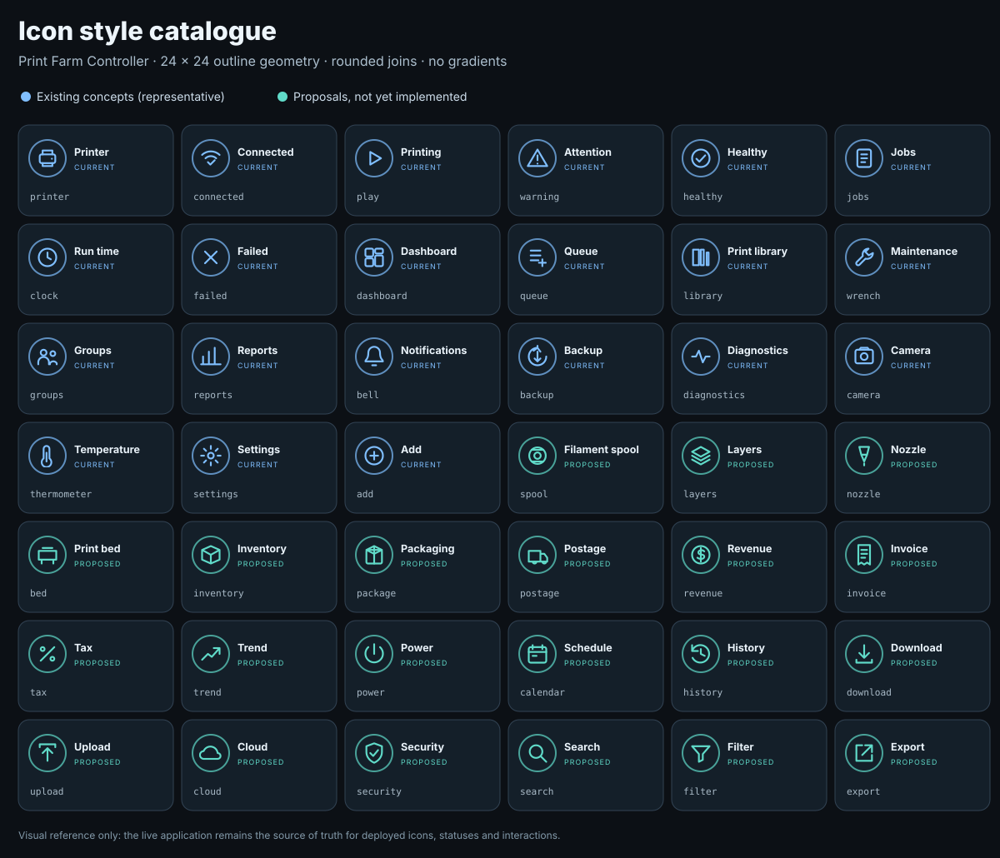

# Print Farm Controller — Visual Style Guide & Icon Catalogue

**Document type:** canonical UI/UX design reference (separate from the README and project handoff)  
**Reference baseline:** v0.59.7 candidate, 21 October 2026 · PR #113 Dashboard refinements  
**Maintained in:** `docs/CONTROLLER_VISUAL_STYLE_GUIDE.md`  
**Scope:** controller web application, desktop and mobile, both themes; Preact and no-bundle fallbacks. The emulator may share principles but has its own stylesheet.  
**Authority:** actual CSS, components and approved UI behaviour take precedence over illustrative samples in this guide. New designs **should conform to these rules** unless explicitly approved as an exception.

## 1. Design character

**Industrial operations SaaS, not a consumer shopping interface.** Professional, calm and information-dense; clear hierarchy, predictable repeated actions and high-value status at a glance. Avoid decorative noise, giant empty regions, unnecessary coloured cell backgrounds, gratuitous animation and multiple competing action styles.

- **Local first:** all core styles, icons, images and scripts are served by the controller. No dependency on CDN fonts, external icon libraries or remote design assets.
- **Consistent:** one visual grammar across Dashboard, Printer Details, Queue & History, Print Library, Printer Groups, Maintenance, Reports & Finance, Alerts, Backup & Recovery, Diagnostics and Licence.
- **Status with meaning:** blue = primary/neutral activity, green = successful/healthy, amber = caution/pause, red = errors/destructive, cyan = working/printing when used. An icon/label must still distinguish status for colour-blind users.
- **Compact but readable:** 42px normal controls, restrained panels, consistent headings, square-ish tables with breathing room, and informative hover/focus/disabled states.
- **Accessible and responsive:** mouse, touch, keyboard, Windows Chrome and Android Chrome; never invent data visualisations or mask printer-control failures.

### Quick visual reference



The icon sheet above intentionally separates **existing concepts** (blue) from **future suggestions** (teal). Suggestions are not implemented features. The shapes provide design candidates, not instructions to change the application's deployed icons.

## 2. CSS and implementation sources

Stylesheets load in this order (later, more specific declarations win):

```text
public/styles.css                 legacy geometry, printer controls, table tokens
public/design-system.css          --ds-* palette, primitives, new Dashboard KPI styling
public/shell.css                  sidebar, top bar, routed workspace
public/dashboard-polish.css       shared page headings, dashboard cards
public/printer-details-polish.css printer identity/detail tabs and forms
public/tab-navigation.css         universal underline tablists and icon masks
public/print-library-polish.css   Library workbench layout and responsive cards
public/auth.css                   Login gate, current account and user-management route
```

`ui/components.jsx` exports the reusable Preact primitives. The relevant page renderers are under `ui/`; `public/app.js` retains controller dispatch and compatibility presentation. `public/styles.css` owns shared `--pfc-table-*` tokens. Avoid visually overriding a new component in a stylesheet that loads later (this previously stacked Dashboard summary text below its icons).

**New UI construction rule:** use tokens rather than copying a neighbouring screen's hard-coded CSS, keep page-owned layout scoped to its route, and test both Preact and fallback paths. Respect established `data-*` hooks, route IDs, printer commands, user drafts and SSE refreshes.

### Native account and access management

Login is a full-viewport access gate served by `public/auth-gate.js` and styled with `public/auth.css`. It is **not** a floating workspace dialog: while signed out, regular workspace/sidebar is inaccessible; do not paint live printer data behind a transparent login overlay. The sign-in panel uses `--ds-page`, `--ds-surface`, `--ds-border`, `--ds-text`, `--ds-brand`, `--ds-radius-lg` and a single primary 42px button; inline errors use `--ds-danger`, and insecure-transport warnings use `--ds-warning`. Preserve light/dark themes and visible keyboard focus.

First-administrator enrollment uses the same full-viewport access gate, with a five-field setup form and clear error handling. Authentication is enabled by default, so setup appears before printer operations when no administrator exists. **Security & users** remains a Farm Management route for signed-in Administrators; only an explicitly configured pre-enrollment legacy mode shows the pre-setup route and optional return-to-workspace action. The setup page explains that the private code comes from protected controller startup logs. HTTP enrollment and sign-in are enabled by default, with a prominent amber warning that passwords and sessions are interceptable; HTTPS is strongly recommended. The warning stays visible on both setup and login screens in both frontend modes. The code is never shown in the browser or ordinary diagnostics. The top bar displays a current user display-name/role text label and a secondary **My account** action for self-service password change and sign-out. Its local page header uses FARM MANAGEMENT eyebrow, primary page title and muted explanatory text, with a compact add-user panel and a responsive list. The user table reuses shared `--pfc-table-*` header, divider, hover and background tokens with dark white uppercase headings and accessible row labels. Password fields must not display stored hashes or existing passwords. Saving changed roles, disabled status or password visibly reports success or errors and signs out the affected user's old sessions.

Role-aware destructive controls: **Delete selected** in the Print Library and **Clear history** in Queue & History are absent for Operators and Viewers. The Reports & Finance filament cost catalogue stays readable but hides the add/edit form and row Edit/Delete controls for non-Administrators in both Preact and legacy renderers. Operators retain operational filament/nozzle assignment buttons on Printer Details. Use native `hidden` plus an explicit CSS `[hidden]` selector when a component has author-level display rules; do not leave disabled destructive controls taking up toolbar space. Visibility by role is only user-experience guidance; **backend authorization is always authoritative**. Screen readers and keyboard users must not be able to interact with locked workspace controls before sign-in, and the sign-in field focus must be restored when applicable. The no-bundle frontend uses the same native login UI, permission states and route identity; never make user security dependent on Preact being available.

## 3. Colour system

### Core semantic palette — exact `--ds-*` tokens

| Purpose | Token | Dark | Light | Default use |
|---|---|---|---|---|
| Page canvas | `--ds-page` | `#0c1015` | `#f1f5f9` | Routed workspace background |
| Card/panel | `--ds-surface` | `#141c24` | `#ffffff` | Panels, fields, controls |
| Raised card | `--ds-surface-raised` | `#1a2631` | `#f6f9fd` | Raised backgrounds, buttons |
| Muted inset | `--ds-surface-muted` | `#0e151c` | `#f3f7fa` | Metrics, form interiors |
| Hover surface | `--ds-surface-hover` | `#1d2a36` | `#edf4fb` | Interactive hover |
| Border | `--ds-border` | `#2d3c4a` | `#cedce6` | Default outlines/dividers |
| Strong border | `--ds-border-strong` | `#466175` | `#92adc3` | Hover/priority distinction |
| Main text | `--ds-text` | `#edf5fb` | `#243849` | Figures, titles, main content |
| Secondary text | `--ds-text-muted` | `#abbecd` | `#496477` | Labels, descriptions |
| De-emphasised | `--ds-text-subtle` | `#849bab` | `#637d8e` | Time, help, metadata |
| Brand/active | `--ds-brand` | `#80bfff` | `#1466bc` | Active links, headings, tab underline |
| Strong brand | `--ds-brand-strong` | `#287cda` | `#1769bd` | Primary gradients or stronger accents |
| Soft brand | `--ds-brand-soft` | `rgba(101,172,253,.13)` | `rgba(25,111,205,.10)` | Selected panels |
| Positive | `--ds-success` | `#57d4a5` | `#217c55` | Success, ready, positive |
| Warning | `--ds-warning` | `#f1c771` | `#8d6117` | Maintenance/attention/pause |
| Dangerous | `--ds-danger` | `#fc8993` | `#ad3441` | Failures, deletion, destructive |
| Informational | `--ds-info` | `#8dbdfa` | `#186aa9` | Neutral system events |
| Keyboard focus | `--ds-focus` | `#98cfff` | `#176cbd` | Focus outline |

Use semantic tokens to build new components. **Some established components use more vivid local palette values** for rings, progress fills and legacy buttons; do not imply they already consume semantic tokens exclusively.

### Accepted component accent examples

| Context | Dark | Light | Meaning |
|---|---|---|---|
| Dashboard total | `#328de2` | `#177bd8` | Neutral fleet count |
| Dashboard online / success ring | `#20b37b` | `#13a76c` | Connection/healthy |
| Dashboard printing ring | `#22b8d0` | `#008ba3` | Active work |
| Dashboard attention ring | `#e8a033` | `#b87611` | Attention needed |
| Analytics failure ring | `#ef515d` | `#e6424e` | Failed attempts |
| Default legacy primary button | `#2878d0` | Theme-specific legacy override | Initiating primary action |
| Default legacy success button | `#237a4b` | Theme-specific legacy override | Positive operation |
| Default legacy caution button | `#8a641d` | Theme-specific legacy override | Pause/attention |
| Default legacy danger button | `#9b343d` | Theme-specific legacy override | Delete/destructive |

**Do not** paint every table cell with a status background. Prefer a compact pill, text, icon, badge or dedicated progress bar while preserving the normal table surface. A green arrow may mean *fewer failures*; a total-jobs increase is informational, not automatically beneficial.

## 4. Typography

**Font stack:** `Inter, ui-sans-serif, system-ui, -apple-system, BlinkMacSystemFont, "Segoe UI", sans-serif`. This is **a preference stack, not a bundled font**. The user's locally available font is used; do not add externally downloaded fonts or font files.

| Text role | Current specification | Typical placement |
|---|---|---|
| Small helper/caption | `--ds-font-xs: .72rem` (about 11.5px at 16px root) | Hints, historical notes |
| Compact body | `--ds-font-sm: .8rem` (12.8px) | Table body, tabs, navigation |
| Medium body | `--ds-font-md: .9rem` (14.4px) | Dense content |
| Larger content | `--ds-font-lg: 1.15rem` (18.4px) | In-panel headings |
| Large content | `--ds-font-xl: 1.5rem` (24px) | Emphasised values |
| Routed page eyebrow | `.66rem`, weight 800, tracking `.14em`, uppercase, brand blue | FARM OPERATIONS, FARM MANAGEMENT |
| Routed title | `clamp(1.28rem,1.65vw,1.72rem)`, weight 800, `-.033em`, 1.25 line-height | Dashboard/route heading |
| Routed description | `.8rem`, weight 400, line-height 1.5 | Explanatory subtitle |
| Dashboard KPI label | `.73rem`, weight 650 | All Printers, Online, Printing, Needs attention |
| Dashboard KPI count | `1.55rem`, weight 850, tabular numerals | Status counts |
| Analytics KPI value | `1.55rem`, weight 850 | Job totals, duration |
| Standard table header | `.68rem`, weight 800, `.04em` tracking, uppercase | Shared data tables |
| Sidebar item | `.8rem`, weight 650; active weight 800 | Navigation |
| Tab text | `.8rem`, weight 700 | Text-and-icon tabs |
| Printer card name | `1rem`, weight 790 | Printer identity |

**Hierarchy rules:** page eyebrow → page title → supporting description → page controls → card/table/sections. Left-align titles and primary body data. Numeric data uses `font-variant-numeric:tabular-nums` and right alignment in numeric table columns. Allow long printer names/filenames to wrap or truncate deliberately with a title/tooltip, never cause overlay collisions. Never choose colour alone as a state cue.

## 5. Spacing, dimensions, shapes, depth

| Scale/token | Actual value | Use |
|---|---|---|
| `--ds-space-1/2/3/4/5/6` | **4 / 8 / 12 / 16 / 20 / 24px** | Standard internal spacing |
| `--ds-radius-sm` | **8px** | Inputs and common buttons |
| `--ds-radius-md` | **12px** | Small cards / grouped controls |
| `--ds-radius-lg` | **16px** | Dashboard/panel cards |
| `--ds-radius-pill` | **999px** | Badges, switches, progress |
| `--ds-button-height` | **42px** | Main interactive buttons |
| `--ds-input-height` | **42px** | Dropdowns, normal fields |
| Sidebar icon | **18px** SVG in 19px holder | Main navigation |
| Tab icon | **17px** monochrome CSS mask | Tab rails |
| KPI outline icon | **27px** SVG | Inside 72px desktop circular ring |
| Dashboard KPI ring (desktop) | **72px** | With text alongside it |
| Dashboard KPI ring (small viewport) | **52px** | With text still alongside it |
| Desktop top bar | **64px** minimum | Global context/action header |
| Tab target | **46px** min-height | Horizontal underline navigation |

Use `--ds-shadow-sm` for quiet elevation; `--ds-shadow-md` for hover/focus emphasis; `--ds-shadow-pop` for dialogs/overlays. Avoid heavy permanent drop-shadows, glowing neon, exaggerated rounding and constant bounce effects. The standard transition is 140ms fast / 220ms normal, `cubic-bezier(.2,.8,.2,1)` unless a specific control defines its own transition.

## 6. Page structure and navigation

- **Persistent sidebar**: approximately 252px desktop; dark `#0e151d` / white in light mode; grouped navigation headings in small tracked uppercase, 42px minimum navigation rows, 18px outline icons, active blue text/soft background and a 3px left accent rail. Version/connectivity/licence information lives near the foot. At <=760px use a keyboard-accessible drawer with backdrop, focus trapping/restoration and Escape dismissal.
- **Top bar**: contains section context and related actions. Main Farm Management routes show *Farm management* in the global top bar; blue local page headings stay screen-specific. Don't repeat redundant breadcrumbs.
- **Workspace heading**: blue uppercase eyebrow, bold primary page title, muted description. Align auxiliary controls alongside or below as width dictates.
- **Sections**: use `UiSurface` or the route's established panel, 12–16px radius, consistent borders/padding; keep related controls close to the data they govern.
- **No floating workspace windows** for core navigation: use routes. Printer Details remains a purpose-specific details dialog with tabs.
- **Navigation tabs**: transparent background, one text-and-icon horizontal rail, subtle lower divider, **3px brand-blue underline** for selected tab, no filled segmented blocks. Overflow horizontally on mobile, preserving Arrow, Home and End keyboard support.
- **Card / table switch**: a semantic `role="switch"` with `aria-checked`, separate from tabs; retained view preference. Do not make it look like a tab.

## 7. Buttons and action hierarchy

| Variant | Visual intent | Typical controls |
|---|---|---|
| `primary` | Brand-blue filled, white text | Add / Assign / Set filament / Bed level / main confirmation |
| `secondary` | Muted surface, outlined when in panels | Open printer / Edit / Cancel dialog |
| `positive` | Green filled/positive border | Resume or explicit success-oriented action |
| `attention` | Amber | Pause / cautionary operational action |
| `danger` | Red filled/outlined, explicit destructive meaning | Delete / Remove sundry / irreversible action |
| `ghost` | No distracting fill, text/icon on background | Tabs, small navigation/inline controls |
| `icon` | Compact icon-only control | Maintenance, reorder, close, navigation with accessible name |

Default ordinary buttons are **42px high**; `ui-button-small` is **32px**, used only for compact contexts. Labels use semibold weight; don't mix random button heights in the same operation group. Keep one obvious primary action. Actions should be `type="button"` unless a genuine form submit, and provide `disabled` plus `aria-busy` while an operation is pending. A danger action must remain red even when adjacent to neutral controls.

**Functional colour conventions:** pause amber, resume blue/green according to the established control context, printer setup actions blue, destructive actions red. If a screen already has a specific approved semantics mapping, follow it rather than standardising away that meaning.

### Button states

| State | Requirement |
|---|---|
| Default | Correct variant, visible text and icon as needed |
| Hover | Slight surface/border response; do not darken data text, filament swatches or metrics |
| Keyboard focus | **2px** visible `--ds-focus` outline, generally 2px offset |
| Active/pressed | Modest click response (e.g. up to 1px translation), not a disruptive reflow |
| Busy | Spinner and `aria-busy`; prevent duplicate printer commands |
| Disabled | Clearly subdued appearance, explanatory tooltip where appropriate, no action |
| Destructive confirmation | Appropriate confirmation and no ambiguity about target |

## 8. Switches, checkboxes, selects and fields

**Dashboard Cards / Table switch (existing)**

- Uses `role="switch"` and `aria-checked`, not the `role="tab"` pattern.
- Overall height **42px**, compact rounded/pill track; **36 × 20px** track, **14px** circular thumb.
- Unchecked track `#34424e`; checked track `#4f8fc2` in the core stylesheet. Thumb is white and translates **16px**. Visible Cards/Table text remains adjacent.
- Keyboard focus gets 2px blue outline. Maintain persisted view state. A screen with similar binary preference should reuse the style, rather than inventing another switch.
- For a different switch, match geometry, semantic labels and `aria-checked`; do not use a generic green/red traffic-light control for normal settings.

**Dashboard Farm operations switch:** this is a second dashboard-level binary toggle placed beside the Cards/Table preference, never a sidebar or topbar menu item. It reuses the identical 42px switch surface, track/thumb, focus outline and semantic `role="switch"`/`aria-checked` state. Off is the safe default on page load; On reveals multi-printer selection controls and bulk-action toolbar on the Dashboard. Switching Off clears selected printers; navigating away from the Dashboard exits selection mode. Disable switching while a bulk operation is running. The controller's existing command confirmation, permission and preflight checks continue to apply. In Preact and fallback modes, keep the same appearance and behavior. The Dashboard control row must have **zero extra margin** on the Printer group selector: on desktop, the Printer group, Dashboard view and Farm operations headings align horizontally, and their 42px select/switch surfaces share the same top edge. When space is constrained, wrap the whole labelled control cleanly without misaligning its heading. Test this with an actual visible group filter in Preact and no-bundle fallback, not only when the group filter is hidden.

**Analytics two-option segmented selectors (existing):** `Top 10 / All files` and `By material type / By filament` are **mutually exclusive selection groups**, not binary on/off switches. Keep `role="group"` with a descriptive `aria-label`, two native `button` controls with truthful `aria-pressed` values, and a visible selected segment. Each segment has a **42px minimum target** (`--ds-button-height`), `--ds-font-sm` semibold text, `--ds-radius-sm` corners, and a grouped inset surface/border using `--ds-surface-muted` and `--ds-border`. Selected state uses `--ds-brand-strong` with white text; the unselected option uses `--ds-text-muted` and a `--ds-surface-hover` hover response. Keyboard focus uses a **2px `--ds-focus` outline**. Both dark and light themes derive from semantic design tokens, not separate hard-coded colour palettes. On mobile both options remain reachable without truncation. Other mutually exclusive table grouping selectors should reuse this pattern rather than inventing a new variant.

**Checkboxes:** show a real checked square with corresponding label; keep at least the normal controller touch target for the clickable row, don't hide the checkbox state behind a purely decorative icon. Selected printer cards and selected Print Library rows have their own subtle highlight.

**Text/select/number fields:** follow `UiTextField`, `UiSelectField`, `UiCheckboxField` where possible. Inputs/selects use a muted inset surface, border `--ds-border`, radius 8px (new token-driven forms) and **42px** nominal height. Labels are muted, around .8rem semibold; hint and validation feedback sit with the field. Use dropdowns for nozzle size, filament types/colours and known enumerations rather than accepting free text; avoid incidental Clear buttons for toolheads where the approved design omits them.

**Validation:** invalid controls get the danger border and inline message; success/alert/empty/busy states must be visually distinct. Preserve unsaved form drafts across live printer telemetry. A controller-wide currency setting belongs in Reports & finance → Price settings, not independently in each costing editor.

## 9. Shared table standard — mandatory

The canonical table design lives in `public/styles.css` (`--pfc-table-*`). This is used by Dashboard **table view**, Alerts, Printer Groups, Diagnostics, multi-toolhead tables, Print Library and Analytics tables for both **Most popular print files** and **Material usage** (By material type and By filament). The Material usage totals row retains its semantic bold treatment on the shared table surface. **Printers needing attention** and **Print file failure analysis** also use the shared dark header, white uppercase headings, consistent cell spacing, horizontal row dividers and hover colours in both themes. The printer-name row header receives the same row geometry as ordinary cells. **Do not create a competing bespoke table style.**

| Table token | Dark | Light / notes |
|---|---|---|
| `--pfc-table-surface` | `#10171d` | `#ffffff` |
| `--pfc-table-border` | `#29343d` | `#cad5de` |
| `--pfc-table-divider` | `#25313a` | `#d5dee5` |
| `--pfc-table-header-background` | `#151e25` | Intentionally dark in both themes |
| `--pfc-table-header-text` | `#ffffff` | White headings in both themes |
| `--pfc-table-hover` | `#151f28` | `#f6f9fb` |
| `--pfc-table-selected` | `#152e39` | `#dceef8` |
| `--pfc-table-secondary` | `#91a3b1` | `#526773` |
| `--pfc-table-radius` | **11px** | Both themes |

A standard table has **white uppercase bold headings** (`.68rem`, 800, `.04em` tracking), dark `#151e25` header background, consistent column alignment, **9px vertical / 12px horizontal** cells where that geometry fits, subtle horizontal dividers and unobtrusive row hover highlight. A final row omits its bottom divider. Do not apply new colourful backgrounds to normal data cells or add heavy vertical gridlines.

- Align **money, quantities, percentages, durations** to the right; use tabular digits and display currencies appropriately (two decimals for ordinary prices unless a specific quote uses different rules).
- Use sortable button headings with a clearly indicated active sort and ascending/descending direction; preserve click and keyboard functionality.
- File column should have adequate width and sensible long-name behaviour; use remaining width for filenames rather than meaningless filler columns.
- Actions align in a consistent trailing column (or contextual toolbar if using single-row selection).
- Large Print Library tables keep toolbar/headings visible while only data rows scroll, with matching scrollbar gutters to maintain column alignment.
- Narrow views may use labelled cards; other tables may retain a deliberate internal horizontal scroll, **never clipped data** or unwanted page-wide horizontal scrolling.
- **Dashboard table view:** Keep the **Actions** column visible at normal laptop widths (including 1280, 1440 and 1512 CSS pixels with the persistent sidebar). Its 11-column desktop layout uses compact, shared header/row tracks and reduced metric/action padding, not a fixed 1556px minimum. Progress, temperatures, layer, remaining, filament and last-seen values may collapse progressively at narrower breakpoints, prioritising Printer, Status and Actions; all data remains available in Card view and Printer Details. Keep header/body column indexing synchronised across Preact and fallback, maintain legible Pause/Resume and Open printer buttons, and test real viewport geometry at multiple widths. Horizontal scrolling is a last resort, not the default for MacBook screens.
- Status and maintenance icons line up vertically with row text and each other. Filament colour circles carry their actual user-selected colour without a second coloured cell background.
- For Analytics popular files, the last columns are **Material**, **Cost** and **Print time**, each occupying a separate column—not a redundant Popularity bar. Missing historical data uses `—`, partial records say `partial`, and incompatible currencies are never summed as if converted.

## 10. KPI cards, charts, printer tiles

**Option D shared headline design:** circular coloured outline SVG inside a ring; count/title/description and a slim **6px** meter or short neutral accent, on the same visual band. Dashboard icon on the **left**, text and meter **to its right**, not underneath. For Dashboard: printer blue, connectivity green, printing cyan, needs-attention amber, zero attention a green check. Ring shows measured status share of printers in selected group; no meaningful fraction for All Printers means a decorative neutral ring. Empty fleet means no invented percentages. Selected KPI remains clickable and visibly pressed without changing metric data.

**Analytics cards:** job total, completed, failed, run time. Completion and failure rings reflect real report rates; other measures use neutral/accent rings. Previous-period arrows compare adjacent equal-duration, same-filter periods. Green means *more completed / fewer failures*, red the inverse, blue neutral activity. Missing prior history displays **No previous period data**; a prior zero baseline displays **From 0**, not infinity.

**Printer tiles:** consistent headers, status pills, maintenance and reorder controls, static local model images, circular filament colour swatches overlaid only on the image area, then job progress, 2×2 metric cards (nozzle, bed, layer, remaining), connection/latency, Open printer. Printer images use `object-fit:contain`, bottom breathing room and a dedicated slot; **subgrid aligns images across one fleet row** despite wrapped names. Crucially, outer fleet rows have no inherited *internal* gaps between hidden status-strip subgrid tracks; separate whole cards with appropriate margins. Never crop the printer model just to fill the tile. Card view stays separate from dense Dashboard table view. Offline printers retain a visible reason below the Open printer button.

**Charts and data visualisations:** blue/cyan/green/red combinations have consistent semantic meaning, dark/light readability, muted axes and concise labels. Draw a marker for a one-day series; show zero-activity dates and integer y-axis values when plotting counts. For a count of 3 on one date, the chart must not be a move-only invisible SVG path. Charts/totals must derive from actual persisted records; avoid fake sample trends in production.

## 11. Status, alerts, messages and feedback

- Status badge: compact pill, uppercase, bold (.72rem), readable foreground and background. Printing/ready/idle green; offline/error red; paused amber. Status text must be visible, not just a coloured dot.
- Maintenance spanner, notification bell, alert triangle and link/action icons use the matching line-icon language, with unread or urgent state indicated clearly. Informational alerts don't require a fake acknowledgment action.
- Use `UiInlineMessage` for appropriate in-context info/success/warning/error and `ToastHost` for transient events. Avoid permanent alerts for normal idle states.
- Skeleton placeholders are neutral and `aria-hidden`; progress bars provide accessible labels/actual values. Unknown/missing data uses em dash or explicit **Not reported**, never zero by assumption.
- Destructive actions show red styling and confirmation. Errors identify the relevant printer/file where useful, rather than silently changing a status colour.

## 12. Icon system — specification and inventory

### Geometry & delivery

- **Base grid:** 24 × 24 `viewBox`, with `fill="none"`, `stroke="currentColor"`, `stroke-linecap="round"` and `stroke-linejoin="round"`.
- **Stroke:** about **1.8–2.2** units. Desktop Dashboard/Analytics KPI icons use **2.2** at 27px; sidebar/tab masks generally use **1.8** at 18/17px.
- **Alignment:** geometrically centred; prefer one recognizable silhouette, at most a couple of interior details; no emoji, filled emoji-like glyphs or accidental mixed icon weights.
- **Sizes:** 17px tabs, 18px nav, ~19–20px utility, 27px KPI icon within 72px/52px ring. Buttons without text need `aria-label` and an appropriate target.
- **Colour:** inherit `currentColor`; semantic parent decides colour. Only use fixed accent colours at the component's semantic layer. Icons may be decorative (`aria-hidden="true"`), but buttons still require accessible names.
- **Source:** use the existing local inline SVG / `data-pfc-icon` CSS-mask pattern; no web icon fonts, remote SVG, unlicensed external packs, images as substitutes for status shapes, or embedded font files.
- **Changes:** never silently replace the Stack Layers/Stacked Layers brand mark. Brand is separate from functional icons. Treat new candidates below as *proposals* until implemented and approved.

### Implemented icon concepts (reference)

| Family | Concepts seen in controller | Typical use |
|---|---|---|
| Dashboard status | `printer`, `connected`, `play/printing`, `warning`, `healthy/check` | Four filter cards and healthy no-attention state |
| Analytics headline | `jobs`, `check`, `cross`, `clock` | Four Option D report totals |
| Navigation | dashboard grid, queue, library/files, maintenance wrench, groups, chart/reports, alert bell/triangle, backup, diagnostics, licence | Sidebar routes and actions |
| Printer detail tabs | sliders, camera, files, thermometer, clock, wrench | Option A text-and-icon underline rail |
| Actions | plus, close, drag/reorder, clear in allowed contexts, arrow/up/down, save/edit, pause/resume, delete | Buttons and compact toolbar utilities |

These are **icon concepts/families**, not guarantees that every illustration in the sheet is a byte-for-byte reproduction of deployed paths. The production SVGs are in `ui/dashboard.jsx`, `ui/reporting.jsx`, `public/index.html` and the tab mask rules in `public/tab-navigation.css`.

### Future-ready icons that match the controller

The next set is **not yet adopted**. It is a curated extension of the current 24px outlined family.

| Proposed icon ID | Meaning | Appropriate future use |
|---|---|---|
| `spool` | Filament reel | Inventory, spool life, spool assignment |
| `layers` | Stacked print layers | Layer analysis, build complexity |
| `nozzle` | Extruder/nozzle | Nozzle swaps, maintenance |
| `bed` | Print plate | Bed clearance, first-layer validation |
| `inventory` | Stock/box inventory | Materials and product stock |
| `package` | Packed goods | Packaging sundries |
| `postage` | Delivery truck | Postage/shipping |
| `revenue` | Money in circulation | Revenue/financial overview |
| `invoice` | Receipt | Itemised costs and estimates |
| `tax` | Percentage | Tax settings |
| `trend` | Rising trend arrow | Production efficiency trends |
| `power` | On/off | Printer power control (only when supported) |
| `calendar` | Date calendar | Recurring maintenance/schedule |
| `history` | Circular clock/undo | Job history |
| `download` / `upload` | File transfer | Export, local import/restore |
| `cloud` | Cloud outline | Connected cloud backup status |
| `security` | Shield/check | Licence/security status |
| `search` | Magnifier | Search/filter fields |
| `filter` | Funnel | Narrowing datasets |
| `export` | Arrow-out | Download/share report |

### Canonical future SVG structure

```html
<svg viewBox="0 0 24 24" fill="none" stroke="currentColor"
     stroke-width="1.8" stroke-linecap="round" stroke-linejoin="round"
     focusable="false" aria-hidden="true">
  <!-- Example: proposed filament spool -->
  <circle cx="12" cy="12" r="8.5" />
  <circle cx="12" cy="12" r="3.3" />
  <path d="M6 6h12M6 18h12" />
</svg>
```

Use `stroke-width="2.2"` for larger KPI badge treatment when it visually matches the existing 27px set. The companion **SVG catalogue** provides complete shapes and IDs for both current and proposed references: `docs/assets/controller-icon-catalog.svg`. Its symbols are **design assets**, not automatically loaded by the app.

## 13. Responsive rules

| Environment | Design requirement |
|---|---|
| Desktop | Four Dashboard KPI boxes across where width permits; workspace sidebar persistent; printer cards form a fluid grid |
| Tablet / constrained desktop | KPI and data columns reflow; avoid stretched empty space and clipped action labels |
| <=1050px | Smaller/adjusted shell/sidebar widths and two-column summary where relevant |
| <=760px | Sidebar drawer, narrower gutters, compact headings, two-column KPI grid and internally scrolling tab rails |
| <=620px | KPI ring goes to 52px with **adjacent** text still in the second grid track |
| 390px / Android Chrome | No horizontal page overflow, all relevant buttons reachable, action labels and figures legible |
| <=320px | Preserve left icon/right text geometry using smaller icon and fluid second column |

Mobile is not a shrunken desktop screenshot. Use single-column printer cards, labelled detail rows and sensible scroll regions. A wide data table may scroll internally if that is safer than clipping it. Allow viewport-relative content heights and maintain scroll clearance beneath the final page panel.

## 14. Interaction and accessibility contract

- Visible hover *and* keyboard focus. `Tab` must expose controls; Enter/Space activate buttons, with native keyboard behaviours for selects/switches.
- Button labels describe actions (`Open printer`, `Set filament`, `Bed cleared`), not arbitrary icons. Icon-only actions must have `aria-label`/`title`.
- Tabs: `role="tablist"`, `role="tab"`, `aria-selected`, referenced tab panels and keyboard navigation. Switches: `role="switch"`, `aria-checked`.
- Progress bars: actual measured `aria-valuenow`, min/max and label; unknown/missing metrics must not claim percentages.
- Do not re-create whole user-editable forms on every SSE status update, reset user input, or swallow clicks by replacing button DOM during mouse-down.
- Respect reduced-motion settings. Avoid flashing banners and colour-only status differentiation.
- Dialog close, Escape/overlay click, mobile sidebar focus trapping and return focus must work.
- Protect status and temperature information with readable contrast against both themes.
- Keep images locally served and aspect-ratio intact; respect filament colour swatches without repainting them on hover.

## 15. Design QA and change-acceptance checklist

Before a visual feature is accepted or merged:

1. Compare against **Dashboard / Printer Details / Reports & finance** in both themes. Shared buttons, tabs, tables, icons and headings must use the same scale.
2. Check named routes and the no-bundle fallback. No broken navigation, licence gating, error paths, camera, upload, queue, printer commands or tab state.
3. Check responsive widths around **1365, 900, 760, 620, 390 and 320px**. No accidental page scrollbar, clipped buttons or text under KPI icons.
4. Check keyboard focus, ARIA descriptions, disabled and busy states, screen-reader names and reduced-motion behaviour.
5. For the Dashboard, confirm **all four summary filters still work**, group scoping, and card/table switching; check long wrapped printer names, static image containment, hidden strip spacing, metrics and footer alignment.
6. For tables, check the **shared dark header/white uppercase text**, sortable headings, aligned body columns, visible actions, hover and selected states, card/scroll behaviour and sparse/long data.
7. For costing and reports, verify currency provenance, incomplete records, date filters and actual progress ratios. Never introduce invented growth arrows, false success rates or empty graphs.
8. Run `npm test`, `npm run build:frontend`, and `npm run test:browser` (Node.js 24); inspect GitHub Chromium visual-regression artifacts for dark/light desktop and mobile.
9. Record substantial design changes in **this guide**, including the icon inventory and any new reusable CSS tokens. Historical implementation milestones remain in the older `docs/DESIGN_SYSTEM.md`; the canonical visual rules are maintained here.

## 16. How to use this document for future UI changes

When designing a new controller screen: select an existing reusable component; choose semantic status/colour; select an implemented icon or a proposed icon from the catalogue; decide the table/field/button/tabs pattern; document any genuinely new interaction state; verify both themes and responsive widths. Add the new icon concept to the **implemented** set *only after* it ships. Avoid a new colour, shadow, border radius, font or button variant when an existing one serves the task.

The controller's visual language should be recognizable across every future feature: **quiet surfaces, blue hierarchy, purposeful status colour, rounded outline icons, compact data, strict tables and predictable interaction.**
