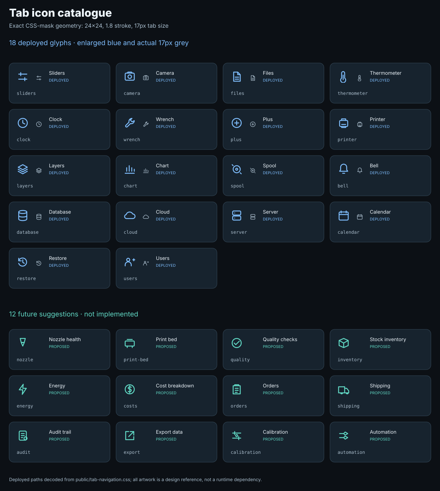
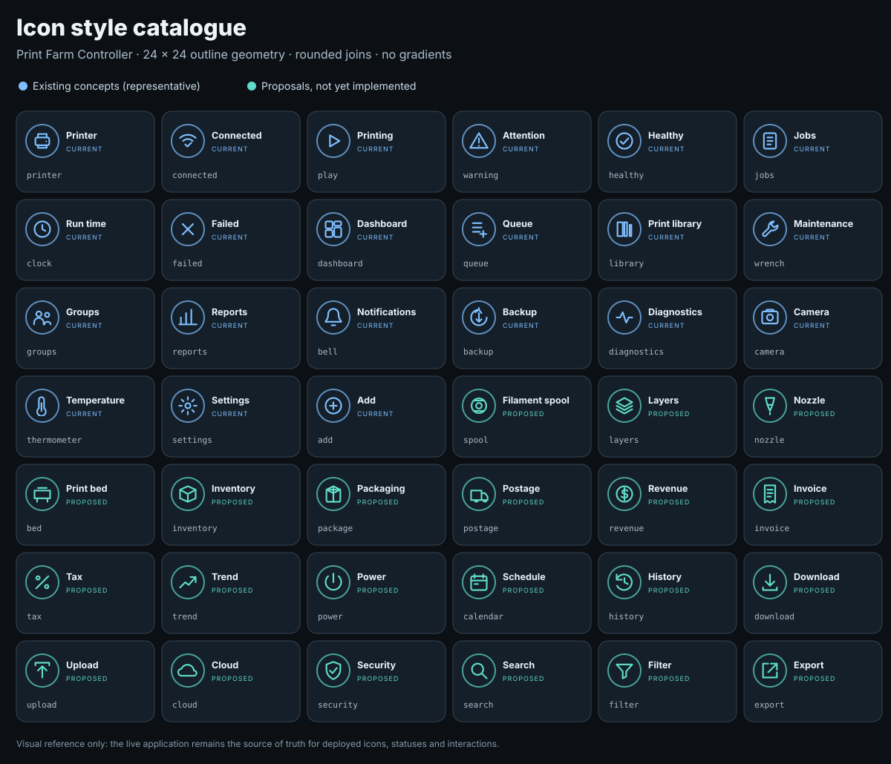

# Print Farm Controller — Visual Style Guide & Icon Catalogue

This is the canonical design reference for the controller web app in both themes, at desktop and mobile widths, with Preact and the no-bundle fallback. The emulator has its own stylesheet. Check the [implementation sources](#2-css-and-implementation-sources) for deployed behaviour and follow the documented standards for new work.

## Contents

- [Foundations](#1-design-character) · [Implementation sources](#2-css-and-implementation-sources) · [Colour](#3-colour-system) · [Typography](#4-typography) · [Spacing and dimensions](#5-spacing-dimensions-shapes-depth)
- [Navigation](#6-page-structure-and-navigation) · [Sign-in and account management](#native-account-and-access-management) · [Printer map](#printer-map)
- [Buttons](#7-buttons-and-action-hierarchy) · [Switches and fields](#8-switches-checkboxes-selects-and-fields) · [Tables](#9-shared-table-standard--mandatory) · [Charts and printer tiles](#10-kpi-cards-charts-printer-tiles) · [Status](#11-status-alerts-messages-and-feedback)
- [Deployed icons](#production-tab-icons--exact-catalogue) · [Responsive layout](#13-responsive-rules) · [Accessibility](#14-interaction-and-accessibility-contract) · [QA checklist](#15-design-qa-and-change-acceptance-checklist) · [Icon proposals](#appendix-a-icon-proposals)

## 1. Design character

**Industrial operations SaaS, not a consumer shopping interface.** Professional, calm and information-dense; clear hierarchy, predictable repeated actions and high-value status at a glance. Avoid decorative noise, giant empty regions, unnecessary coloured cell backgrounds, gratuitous animation and multiple competing action styles.

- **Local first:** all core styles, icons, images and scripts are served by the controller. No dependency on CDN fonts, external icon libraries or remote design assets.
- **Consistent:** one visual grammar across Dashboard, Printer Details, Queue & History, Print Library, Printer Groups, Maintenance, Reports & Finance, Alerts, Backup & Recovery, Diagnostics and Licence.
- **Status with meaning:** blue = primary/neutral activity, green = successful/healthy, amber = caution/pause, red = errors/destructive, cyan = working/printing when used. An icon/label must still distinguish status for colour-blind users.
- **Compact but readable:** 42px normal controls, restrained panels, consistent headings, square-ish tables with breathing room, and informative hover/focus/disabled states.
- **Accessible and responsive:** mouse, touch, keyboard, Windows Chrome and Android Chrome; never invent data visualisations or mask printer-control failures.

## 2. CSS and implementation sources

The [controller entry point](../public/index.html) loads these stylesheets in order. Use the entry point to verify the current cascade.

```text
public/styles.css                 legacy geometry, printer controls, table tokens
public/design-system.css          --ds-* palette, primitives, new Dashboard KPI styling
public/shell.css                  sidebar, top bar, routed workspace
public/dashboard-polish.css       shared page headings, dashboard cards
public/printer-details-polish.css printer identity/detail tabs and forms
public/tab-navigation.css         universal underline tablists and icon masks
public/print-library-polish.css   Library workbench layout and responsive cards
public/printer-map.css            Map editor, fitted views and character animation
public/auth.css                   Login gate, current account and user-management route
```

`ui/components.jsx` exports the reusable Preact primitives. Page renderers live under `ui/`. `public/app.js` owns controller dispatch and the no-bundle presentation, and `public/styles.css` owns the shared `--pfc-table-*` tokens. Keep route-specific overrides scoped to their own components.

**New UI construction rule:** use tokens rather than copying a neighbouring screen's hard-coded CSS, keep page-owned layout scoped to its route, and test both Preact and fallback paths. Respect established `data-*` hooks, route IDs, printer commands, user drafts and SSE refreshes.

### Native account and access management

#### Sign-in layout

- Serve the full-viewport access gate through `public/auth-gate.js` and `public/auth.css`. Hide the workspace and sidebar from sight, keyboard navigation and assistive technology while signed out.
- Use the three-polygon Stacked Layers logo (`viewBox="0 0 120 92"`) from the sidebar. The desktop Industrial Control Centre layout places the brand panel on the left and the form on the right. At 980px and below, use a compact brand header above the full-width form.
- Keep the primary button at 42px, keyboard focus visible, form errors in `--ds-danger`, and the insecure HTTP notice prominent in `--ds-warning` on sign-in and setup in both themes. The password visibility button reflects its state with `aria-pressed`. Preserve focus restoration and usable forms at mobile widths.

#### Sign-in illustration

- Render a local, decorative, `aria-hidden` SVG of an 18-layer stepped pyramid growing on a diamond bed in a 45° isometric view. The illustration and its layer counter represent a time-lapse. Keep live printer data, simulated status banners and large gantry frames out of the scene.
- Use `projectPrintPoint()` for the grid, workpiece and nozzle. Each tier shrinks by 4 SVG units and rises by 5.2. The first perimeter follows (177,241), (330,169), (483,241) and (330,313). The bed fits in x=56..609 and y=56..362. The amber nozzle guide extends at most 47 units above its tip. Use the same `#authExtrusionPath`, `getPointAtLength()` and stroke-dash distance for the nozzle and deposited filament. Accumulate front faces and blue tier outlines as the part grows.
- Use a stationary radial illumination on `--ds-surface-raised`, faint contact shadows and a thin diagonal calibration grid clipped to the bed. Centre the `Layer NN / 18` counter and slim blue progress track below the bed. Drive both from toolpath progress. Theme the scene with `--ds-*` tokens.
- Above 980px, begin a roughly two-second zoom-out as layer 04 starts. The original nozzle continues extruding as its bed becomes the upper-left scene of a four-bed schematic. The other three scenes each use the same projected geometry with separate toolpaths, nozzles, progress and accumulated faces. Route connections to one Stacked Layers controller. Leave at least 5 CSS px between the scaled progress bars and printer names at the tested desktop viewport. Hold briefly, return smoothly to the close-up and repeat with staggered loops.
- At 521–980px, retain the smaller single-printer illustration. At 520px and below, use the animated layer line in the brand mark.
- Use one bounded `requestAnimationFrame` loop and suspend it when the gate is hidden or the tab is backgrounded. The sign-in illustration has an approved reduced-motion exception. Its slow, non-flashing motion starts automatically, including when the browser requests reduced motion. Keep it passive, with no play/pause control, stored motion preference, ambient pulses or whole-page movement.
- Browser checks cover nozzle/toolpath alignment, shrinking footprints, rising tiers, automatic motion, the connected-farm reveal and the absence of a play/pause control.

#### Enrollment and user management

See [Authentication and RBAC](AUTHENTICATION_AND_RBAC.md#account-and-session-lifecycle) for enrollment, authorization and session rules, and [HTTPS setup](HTTPS_CONFIGURATION.md#browser-ports-and-initial-setup) for secure onboarding.

- Use the access gate for first-administrator enrollment, with the five-field setup form and inline errors. Explain where to find the private setup code in protected startup logs. Show the return-to-workspace action only when the configured pre-enrollment legacy mode permits it.
- Show the signed-in display name and role in the top bar and offer a secondary **My account** action for password change and sign-out. At 390px and below, let the identity wrap and put the identity, account and theme controls on their own header row.
- **Users & settings** is an Administrator route. Use the Farm Management page heading, a compact add-user panel and a responsive user list built on the [shared table standard](#9-shared-table-standard--mandatory). Show changes to roles, account status or passwords with visible save feedback.
- Use a red **Delete** beside **Save** in the Actions cell. Disable self-deletion with an explanation, confirm other deletions with the target name, and show failures inline. Refresh the list after a successful deletion.
- Apply the same role visibility in both frontend modes. Hide **Delete selected** in the Print Library and **Clear history** in Queue & History for Operators and Viewers. Keep the filament cost catalogue readable while hiding Administrator-only editing controls. Operators retain the operational filament and nozzle assignment controls. Use native `hidden` and an explicit CSS `[hidden]` rule where author-level display styles would otherwise override it.

#### Connection settings

Use the [standard underline tabs](#production-tab-icons--exact-catalogue) below the Users & settings heading. **Users**, **Connection settings** and **Resource limits** use the Users, Server and Sliders icons. Keep inactive panels and their controls hidden. Load the user list and certificate details when their respective tabs open.

| Section | Presentation and behaviour |
|---|---|
| Connection summary | Show certificate source, listener ports, redirect mode, subject, DNS/IP SANs, expiry and SHA-256 fingerprint as readable definition pairs. Wrap long values and use a secondary link-button for the public certificate download. |
| Connection settings | Use standard 42px fields and buttons, with responsive monospace text areas for **Public certificate (PEM)** and **Private key (PEM)**. Keep PEM fields blank on load, hide fields that do not apply to the selected mode, and require the administrator password and a confirmation checkbox. Show the actual listener ports as read-only values. |
| Self-signed certificate replacement | Show this section only when the saved mode uses controller-managed self-signed HTTPS. Keep the amber **Regenerate self-signed certificate** action after Connection settings. Require the administrator password, an acknowledgement checkbox and browser confirmation. Show busy and status feedback. |

Keep the panel in the page using `auth-panel` and the shared theme tokens. Collapse to one column on narrow screens. Use clear browser-facing labels and a concrete reconnect URL after a change. Keep trust, insecure HTTP and session-revocation notices legible in both themes. When importing requires reconnecting over HTTPS, explain how to enable managed HTTPS first. See [HTTPS configuration](HTTPS_CONFIGURATION.md#safely-importing-external-pem-certificates) for PEM handling, listener behaviour, saved modes and the unchanged-settings case.

#### Resource limits

- Use labelled fieldsets for Uploads, Storage, Sessions and streams, Backup processing and Timeouts. Use 42px number inputs with count, MiB/GiB or seconds labels. Show active and default values and explain disabled host-managed fields. Put fixed caps in a neutral expandable read-only section.
- Show restart state above the form. **Save resource limits** is primary. **Use default values** prepares a draft and **Reload saved limits** discards it. Preserve edits across tab and telemetry updates, disable editing while saving, and show loading, validation and save feedback as accessible status text. Distinguish saved values from active values pending restart.
- Use one field column at 760px and below. Wrap actions at phone widths and keep the layout within 320px. The native account renderer supplies the same controls in both frontend modes.

## 3. Colour system

### Core semantic palette — exact `--ds-*` tokens

| Purpose | Token | Dark | Light | Default use |
|---|---|---|---|---|
| Page canvas | `--ds-page` | `#0c1015` | `#f1f5f9` | Routed workspace background |
| Card/panel | `--ds-surface` | `#141c24` | `#ffffff` | Panels, fields, controls |
| Raised card | `--ds-surface-raised` | `#1a2631` | `#f6f9fd` | Raised backgrounds, buttons |
| Muted inset | `--ds-surface-muted` | `#0e151c` | `#f3f7fa` | Metrics, form interiors |
| Hover surface | `--ds-surface-hover` | `#1d2a36` | `#edf4fb` | Interactive hover |
| Border | `--ds-border` | `#2d3c4a` | `#cedce6` | Default outlines/dividers |
| Strong border | `--ds-border-strong` | `#466175` | `#92adc3` | Hover/priority distinction |
| Main text | `--ds-text` | `#edf5fb` | `#243849` | Figures, titles, main content |
| Secondary text | `--ds-text-muted` | `#abbecd` | `#496477` | Labels, descriptions |
| De-emphasised | `--ds-text-subtle` | `#849bab` | `#637d8e` | Time, help, metadata |
| Brand/active | `--ds-brand` | `#80bfff` | `#1466bc` | Active links, headings, tab underline |
| Strong brand | `--ds-brand-strong` | `#287cda` | `#1769bd` | Primary gradients or stronger accents |
| Soft brand | `--ds-brand-soft` | `rgba(101,172,253,.13)` | `rgba(25,111,205,.10)` | Selected panels |
| Positive | `--ds-success` | `#57d4a5` | `#217c55` | Success, ready, positive |
| Warning | `--ds-warning` | `#f1c771` | `#8d6117` | Maintenance/attention/pause |
| Dangerous | `--ds-danger` | `#fc8993` | `#ad3441` | Failures, deletion, destructive |
| Informational | `--ds-info` | `#8dbdfa` | `#186aa9` | Neutral system events |
| Keyboard focus | `--ds-focus` | `#98cfff` | `#176cbd` | Focus outline |

Use semantic tokens to build new components. **Some established components use more vivid local palette values** for rings, progress fills and legacy buttons; do not imply they already consume semantic tokens exclusively.

### Accepted component accent examples

| Context | Dark | Light | Meaning |
|---|---|---|---|
| Dashboard total | `#328de2` | `#177bd8` | Neutral fleet count |
| Dashboard online / success ring | `#20b37b` | `#13a76c` | Connection/healthy |
| Dashboard printing ring | `#22b8d0` | `#008ba3` | Active work |
| Dashboard attention ring | `#e8a033` | `#b87611` | Attention needed |
| Analytics failure ring | `#ef515d` | `#e6424e` | Failed attempts |
| Default legacy primary button | `#2878d0` | Theme-specific legacy override | Initiating primary action |
| Default legacy success button | `#237a4b` | Theme-specific legacy override | Positive operation |
| Default legacy caution button | `#8a641d` | Theme-specific legacy override | Pause/attention |
| Default legacy danger button | `#9b343d` | Theme-specific legacy override | Delete/destructive |

**Do not** paint every table cell with a status background. Prefer a compact pill, text, icon, badge or dedicated progress bar while preserving the normal table surface. A green arrow may mean *fewer failures*; a total-jobs increase is informational, not automatically beneficial.

## 4. Typography

**Font stack:** `Inter, ui-sans-serif, system-ui, -apple-system, BlinkMacSystemFont, "Segoe UI", sans-serif`. This is **a preference stack, not a bundled font**. The user's locally available font is used; do not add externally downloaded fonts or font files.

| Text role | Current specification | Typical placement |
|---|---|---|
| Small helper/caption | `--ds-font-xs: .72rem` (about 11.5px at 16px root) | Hints, historical notes |
| Compact body | `--ds-font-sm: .8rem` (12.8px) | Table body, tabs, navigation |
| Medium body | `--ds-font-md: .9rem` (14.4px) | Dense content |
| Larger content | `--ds-font-lg: 1.15rem` (18.4px) | In-panel headings |
| Large content | `--ds-font-xl: 1.5rem` (24px) | Emphasised values |
| Routed page eyebrow | `.66rem`, weight 800, tracking `.14em`, uppercase, brand blue | FARM OPERATIONS, FARM MANAGEMENT |
| Routed title | `clamp(1.28rem,1.65vw,1.72rem)`, weight 800, `-.033em`, 1.25 line-height | Dashboard/route heading |
| Routed description | `.8rem`, weight 400, line-height 1.5 | Explanatory subtitle |
| Dashboard KPI label | `.73rem`, weight 650 | All Printers, Online, Printing, Needs attention |
| Dashboard KPI count | `1.55rem`, weight 850, tabular numerals | Status counts |
| Analytics KPI value | `1.55rem`, weight 850 | Job totals, duration |
| Standard table header | `.68rem`, weight 800, `.04em` tracking, uppercase | Shared data tables |
| Sidebar item | `.8rem`, weight 650; active weight 800 | Navigation |
| Tab text | `.8rem`, weight 700 | Text-and-icon tabs |
| Printer card name | `1rem`, weight 790 | Printer identity |

**Hierarchy rules:** page eyebrow → page title → supporting description → page controls → card/table/sections. Left-align titles and primary body data. Numeric data uses `font-variant-numeric:tabular-nums` and right alignment in numeric table columns. Allow long printer names/filenames to wrap or truncate deliberately with a title/tooltip, never cause overlay collisions. Never choose colour alone as a state cue.

## 5. Spacing, dimensions, shapes, depth

| Scale/token | Actual value | Use |
|---|---|---|
| `--ds-space-1/2/3/4/5/6` | **4 / 8 / 12 / 16 / 20 / 24px** | Standard internal spacing |
| `--ds-radius-sm` | **8px** | Inputs and common buttons |
| `--ds-radius-md` | **12px** | Small cards / grouped controls |
| `--ds-radius-lg` | **16px** | Dashboard/panel cards |
| `--ds-radius-pill` | **999px** | Badges, switches, progress |
| `--ds-button-height` | **42px** | Main interactive buttons |
| `--ds-input-height` | **42px** | Dropdowns, normal fields |
| Sidebar icon | **18px** SVG in 19px holder | Main navigation |
| Tab icon | **17px** monochrome CSS mask | Tab rails |
| KPI outline icon | **27px** SVG | Inside 72px desktop circular ring |
| Dashboard KPI ring (desktop) | **72px** | With text alongside it |
| Dashboard KPI ring (small viewport) | **52px** | With text still alongside it |
| Desktop top bar | **64px** minimum | Global context/action header |
| Tab target | **46px** min-height | Horizontal underline navigation |

Use `--ds-shadow-sm` for quiet elevation; `--ds-shadow-md` for hover/focus emphasis; `--ds-shadow-pop` for dialogs/overlays. Avoid heavy permanent drop-shadows, glowing neon, exaggerated rounding and constant bounce effects. The standard transition is 140ms fast / 220ms normal, `cubic-bezier(.2,.8,.2,1)` unless a specific control defines its own transition.

## 6. Page structure and navigation

- **Persistent sidebar**: approximately 252px desktop; dark `#0e151d` / white in light mode; grouped navigation headings in small tracked uppercase, 42px minimum navigation rows, 18px outline icons, active blue text/soft background and a 3px left accent rail. Version/connectivity/licence information lives near the foot. At <=760px use a keyboard-accessible drawer with backdrop, focus trapping/restoration and Escape dismissal.
- **Sidebar navigation count badges**: every visible count uses a **fixed 48×24px pill** (`--ds-radius-pill`), right-aligned in its menu row with centred bold **tabular numerals**. Maintain the identical width, height and right-edge alignment for simultaneous single-, double- and triple-digit counts (e.g. Queue 3 and Print Library 125) in both light/dark themes and the mobile drawer. Hide zero-count badges as before. For values above 999 display `999+` without stretching the pill and expose the exact count in a tooltip. Scope this sizing to sidebar navigation; counters on other buttons and content retain their existing geometry and colours.
- **Top bar**: contains section context and related actions. Main Farm Management routes show *Farm management* in the global top bar; Users & settings uses its own name in the top bar and local page heading, with descriptions covering accounts, connection security and controller limits. Keep its existing people/add menu icon. Blue local page headings stay screen-specific. Don't repeat redundant breadcrumbs.
- **Workspace heading**: blue uppercase eyebrow, bold primary page title, muted description. Align auxiliary controls alongside or below as width dictates.
- **Sections**: use `UiSurface` or the route's established panel, 12–16px radius, consistent borders/padding; keep related controls close to the data they govern.
- **No floating workspace windows** for core navigation: use routes. Printer Details remains a purpose-specific details dialog with tabs.
- **Navigation tabs**: transparent background, one text-and-icon horizontal rail, subtle lower divider, **3px brand-blue underline** for selected tab, no filled segmented blocks. Overflow horizontally on mobile, preserving Arrow, Home and End keyboard support.

### Printer map

#### Room selector and printer tiles

- Place Printer map between Dashboard and Queue & history with an 18px folded-map icon. Use a labelled room selector and a dotted plan with 15px square steps. Let the room dimensions determine the canvas. Keep horizontal scrolling inside the panel.
- Align **New map** and **Edit map** with the 42px selector and wrap the buttons together when space is tight. Replace the selector and its action row with the editor while editing.
- Preserve the aspect ratio of Dashboard printer artwork within 120 × 64px for standard tiles or 84 × 40px for compact tiles. Use the generic icon for models without artwork. Wrap names onto up to two lines above the alert, printing and queue flags, with the full name in a tooltip.
- In view mode, make the image and name, alert flag and queue count separate focusable actions. The image and name open Printer Details. The alert and queue actions open lists scoped to that printer with a clear way back to all alerts or jobs.
- Show measured print progress as a thin bar along the bottom of the tile. Use an accessible amber build-plate badge while clearance is pending. Keep these indicators within the existing tile footprint.
- In saved map views, briefly outline a tile in green on completion, expand the badge once for a new alert, highlight the queue badge when a job starts, and fade the tile back in on reconnect. Respond to live changes after the first snapshot. With reduced motion, show the same status with immediate updates.

#### Editing and placement

- Use the tile as one selection and drag target in edit mode. Snap its top-left corner to the nearest grid dot. Arrow keys move one step, or three with Shift. Save the room layout explicitly.
- Give layout items a wrapping palette of 42px secondary icon buttons, each with an accessible name and tooltip. Drag an icon to show a snapped preview and place it on release. Click or press Enter to place at the default position.
- Give a single selected item a focus outline and corner resize handle. Keep the opposite corner fixed and stop at the last whole grid step inside the room.
- Double-click a labelable item or focus it and press F2 to edit the label in place. Enter or moving focus applies the draft label. Escape restores the previous label.
- Draw a translucent selection box from empty space to select fully enclosed printers and room items. Drag one selected item or use the arrow keys to move the group and preserve the relative spacing. Click the floor to select it. Drag an unselected floor to start box selection, or drag a selected floor to move it. Keep the selected floor’s resize handle above other items.

#### Room artwork

Draw room items behind printer tiles with restrained outlines, fills and shading in both themes. Scale the artwork with its footprint. Place floor items underneath the room and keep grid dots visible on the warm-grey surface. Put editable labels inside the bottom edge. Floors, benches, racks, shelves, windows, plant pots, chairs and stools have no labels.

| Item | On-map treatment |
|---|---|
| Bench | Butcher block with staggered planks, restrained grain and a darker front edge. Keep plank scale fixed and run the grain along the longest edge, horizontally on square benches. |
| Rack and shelf | Open wire rack with perimeter rails and four round steel posts. The shelf is a shallow wooden board with steel end brackets and room for four decorative parts. |
| Plant pot, chair and stool | Top-down rubber plant in a round pot, padded task chair with armrests and casters, and round timber stool. |
| Computer and Controller | Desktop workstation with monitor, keyboard and mouse. The Controller is a graphite Mini PC with the Stacked Layers mark and its label below the artwork. |

Keep outline icons in the palette. Give the task chair and workstation a secondary 90° clockwise rotation action. Swap their footprint dimensions on each turn and keep them inside the room.

#### Walls, doors and windows

- Walls and lines have horizontal or vertical orientation. Use two steps across the short axis, or one in a one-step room. Draw strokes on the centreline and join touching pieces of the same type.
- Draw a door with leaf, hinge, jambs and a dashed swing arc. Give selected doors a four-direction swing selector and hinge flip. When a parallel wall centreline crosses the door and its end is within one grid step of a jamb, align the doorway to it and extend the wall to the jamb. Scale the leaf and swing arc within the opening.
- Keep the four-pane window in the palette. Draw the top-down window as an industrial steel frame with two mullions and parallel glazing along its long axis. Snap it to a parallel wall centreline and join nearby wall ends to its jambs. If it sits inside a wall, draw the wall on either side of the opening.

#### Character animation

On saved maps with a Computer item, show the top-down character in a blue overshirt at room-item scale. Give it walking, pickup, shelf drop-off and seated poses. Leave clearance around furniture and printer tiles and tie the alternating foot motion to travel speed. Exclude the character from map fitting and interaction targets.

Show a small carried part after pickup and place it into a free shelf slot on drop-off. During an idle trip, the character can collect a staged part from a reachable shelf and carry it out through a reachable door. Swing the door leaf around its hinge during interior crossings and when the character leaves or returns. Close it after each crossing. Give the workstation screen a soft glow while the character is seated there.

Follow the browser’s reduced-motion setting by default. Offer the [standard Animate person switch](#8-switches-checkboxes-selects-and-fields) on the saved map, in full screen and on the monitoring display. Persist the choice in that browser and apply it to the map character.

#### Full screen and monitoring

- Centre and fit the occupied layout with a small grid margin, trimming unused outer grid space. Fit the grid on empty maps. Scale items, artwork, names and flags together and refit on viewport resize.
- Put the sidebar Stacked Layers lockup at the upper left and retain the room name. Inset the standard 42px secondary **Exit full screen** button so its focus outline clears the viewport. Place the brand on its own row at narrow widths. Restore the normal map’s scroll position on exit.
- Reuse the fitted map and brand header on the monitoring page. Use passive printer tiles and provide a browser fullscreen control. Keep editing and controller navigation outside that page.

## 7. Buttons and action hierarchy

| Variant | Visual intent | Typical controls |
|---|---|---|
| `primary` | Brand-blue filled, white text | Add / Assign / Set filament / Bed level / main confirmation |
| `secondary` | Muted surface, outlined when in panels | Open printer / Edit / Cancel dialog |
| `positive` | Green filled/positive border | Resume or explicit success-oriented action |
| `attention` | Amber | Pause / cautionary operational action |
| `danger` | Red filled/outlined, explicit destructive meaning | Delete / Remove sundry / irreversible action |
| `ghost` | No distracting fill, text/icon on background | Tabs, small navigation/inline controls |
| `icon` | Compact icon-only control | Maintenance, reorder, close, navigation with accessible name |

Default ordinary buttons are **42px high**; `ui-button-small` is **32px**, used only for compact contexts. Labels use semibold weight; don't mix random button heights in the same operation group. Keep one obvious primary action. Actions should be `type="button"` unless a genuine form submit, and provide `disabled` plus `aria-busy` while an operation is pending. A danger action must remain red even when adjacent to neutral controls.

**Functional colour conventions:** pause amber, resume blue/green according to the established control context, printer setup actions blue, destructive actions red. If a screen already has a specific approved semantics mapping, follow it rather than standardising away that meaning.

**Individual printer maintenance actions:** Inside each Individual printer tasks card, Complete, Edit (printer/model/group task) and Delete (printer/model/group task) occupy the same respective columns in every row. Use fixed **120px Complete / 176px Edit / 190px Delete** button widths, keeping the existing 7px gaps, semantic button variants and disabled states. These widths are scoped to `.maintenance-task > .maintenance-task-actions` only; the Model-wide and Group-wide task lists retain their existing buttons. At phone widths (≤620px), stack the three buttons at equal full-row widths to avoid clipping or horizontal scrolling. Verify matching corresponding column edges in both themes and all printer-task scopes.

### Button states

| State | Requirement |
|---|---|
| Default | Correct variant, visible text and icon as needed |
| Hover | Slight surface/border response; do not darken data text, filament swatches or metrics |
| Keyboard focus | **2px** visible `--ds-focus` outline, generally 2px offset |
| Active/pressed | Modest click response (e.g. up to 1px translation), not a disruptive reflow |
| Busy | Spinner and `aria-busy`; prevent duplicate printer commands |
| Disabled | Clearly subdued appearance, explanatory tooltip where appropriate, no action |
| Destructive confirmation | Appropriate confirmation and no ambiguity about target |

## 8. Switches, checkboxes, selects and fields

**Toggle switch standard**

- Use the Light/Dark switch design for binary toggles. Reuse `.ui-switch`, `.ui-switch-track` and `.ui-switch-label`. The pill has a 40px minimum height, a 36 × 20px track and a white 14px thumb. The unchecked track uses `#34424e` in dark mode and `#9aabb8` in light mode. The checked track uses `#4f8fc2` and the thumb moves 16px. Keyboard focus gets a 2px blue outline.
- Use a native button with `role="switch"`, `aria-checked` and an accessible name. The top-bar theme switch shows the active theme name and hides that text at 760px and below. The checked state represents Dark.
- The Printer map’s **Animate person** switch keeps its visible label and stable accessible name in the map toolbar, full-screen view and monitoring display.

### Dashboard switches

- Use the shared pill at 42px for **Cards / Table** and **Farm operations**. Keep the state labels visible and persist the Cards/Table preference.
- On desktop, align both switch surfaces with the top of the Printer group select and align all three field headings. Keep extra margin off the select. Wrap each labelled control together at narrower widths. Verify alignment with a visible Printer group in both frontend modes.
- Place **Farm operations** beside Cards/Table. Default to Off on page load. Turning it on reveals multi-printer selection and the bulk-action toolbar. Turning it off clears the selection. Leaving the Dashboard exits selection mode. Disable the switch during a bulk operation and retain the established confirmation, permission and preflight checks.

**Analytics two-option segmented selectors (existing):** `Top 6 / All files` and `By material type / By filament` are **mutually exclusive selection groups**, not binary on/off switches. Keep `role="group"` with a descriptive `aria-label`, two native `button` controls with truthful `aria-pressed` values, and a visible selected segment. Each segment has a **42px minimum target** (`--ds-button-height`), `--ds-font-sm` semibold text, `--ds-radius-sm` corners, and a grouped inset surface/border using `--ds-surface-muted` and `--ds-border`. Selected state uses `--ds-brand-strong` with white text; the unselected option uses `--ds-text-muted` and a `--ds-surface-hover` hover response. Keyboard focus uses a **2px `--ds-focus` outline**. Both dark and light themes derive from semantic design tokens, not separate hard-coded colour palettes. On mobile both options remain reachable without truncation. Other mutually exclusive table grouping selectors should reuse this pattern rather than inventing a new variant.

**Checkboxes:** show a real checked square with corresponding label; keep at least the normal controller touch target for the clickable row, don't hide the checkbox state behind a purely decorative icon. Selected printer cards and selected Print Library rows have their own subtle highlight.

**Text/select/number fields:** follow `UiTextField`, `UiSelectField`, `UiCheckboxField` where possible. Inputs/selects use a muted inset surface, border `--ds-border`, radius 8px (new token-driven forms) and **42px** nominal height. Labels are muted, around .8rem semibold; hint and validation feedback sit with the field. Use dropdowns for nozzle size, filament types/colours and known enumerations rather than accepting free text; avoid incidental Clear buttons for toolheads where the approved design omits them.

**Validation:** invalid controls get the danger border and inline message; success/alert/empty/busy states must be visually distinct. Preserve unsaved form drafts across live printer telemetry. A controller-wide currency setting belongs in Reports & finance → Price settings, not independently in each costing editor.

## 9. Shared table standard — mandatory

The canonical table design lives in `public/styles.css` (`--pfc-table-*`). This is used by Dashboard **table view**, Alerts, Printer Groups, Diagnostics, multi-toolhead tables, Print Library and the Analytics tables for **Most popular print files**, **Printers needing attention** and **Print file failure analysis**. The latter tables use the shared dark header, white uppercase headings, consistent cell spacing, horizontal dividers and hover colours in both themes. **Do not create a competing bespoke table style.**

| Table token | Dark | Light / notes |
|---|---|---|
| `--pfc-table-surface` | `#10171d` | `#ffffff` |
| `--pfc-table-border` | `#29343d` | `#cad5de` |
| `--pfc-table-divider` | `#25313a` | `#d5dee5` |
| `--pfc-table-header-background` | `#151e25` | Intentionally dark in both themes |
| `--pfc-table-header-text` | `#ffffff` | White headings in both themes |
| `--pfc-table-hover` | `#151f28` | `#f6f9fb` |
| `--pfc-table-selected` | `#152e39` | `#dceef8` |
| `--pfc-table-secondary` | `#91a3b1` | `#526773` |
| `--pfc-table-radius` | **11px** | Both themes |

A standard table has **white uppercase bold headings** (`.68rem`, 800, `.04em` tracking), dark `#151e25` header background, consistent column alignment, **9px vertical / 12px horizontal** cells where that geometry fits, subtle horizontal dividers and unobtrusive row hover highlight. A final row omits its bottom divider. Do not apply new colourful backgrounds to normal data cells or add heavy vertical gridlines.

- Align **money, quantities, percentages, durations** to the right; use tabular digits and display currencies appropriately (two decimals for ordinary prices unless a specific quote uses different rules).
- Use sortable button headings with a clearly indicated active sort and ascending/descending direction; preserve click and keyboard functionality.
- File column should have adequate width and sensible long-name behaviour; use remaining width for filenames rather than meaningless filler columns.
- Actions align in a consistent trailing column (or contextual toolbar if using single-row selection).
- **Print Library layout:** The Print Library route uses the **same full available sidebar-aware workspace width** as the other pages; do not reintroduce a narrower 1300px dialog cap. Its table header and body span the routed page, with price/history tracks capped so extra width benefits filename, filament and other descriptive columns. Keep Sale lots on one line with room for its sort indicator and matching header/body track widths. Keep toolbar/headings visible while only data rows scroll, with matching scrollbar gutters to maintain column alignment. At narrow viewport widths retain labelled cards and avoid page-wide horizontal scrolling.
- **Library accounts:** Include Uploaded by as its own sortable desktop column after File, using the same header/body grid tracks and shared table tokens. Show it as a labelled field on responsive cards. The uploader filter includes My uploads, named accounts, Unknown / legacy and Deleted accounts. Expanded filters allow normal vertical page flow with a bounded, non-collapsing result region; collapsed panels retain the row-scrolling workbench. Mobile search uses an automatic height rather than a desktop flex basis. Personal usage is neutral inline text; the top-bar account label includes personal library bytes and allowance with safe mobile wrapping. The administrator-only Print library tab sits immediately after Analytics in Reports & finance, using the database icon. Its account pie has named byte/percentage legends in a shared-token table; its capacity graph shows actual disk observations and the configured maximum with distinct solid/dashed strokes, readable axes and point tooltips. Both renderers share this view. Include empty/single-observation states, leave offline gaps disconnected and never invent pre-upgrade history. Keep all-account usage off the Print Library page. Change quota owner is a secondary selected-file action visible only to administrators. Its standard modal shows current/target quota ownership, explicit confirmation, errors/busy state and bounded history; original upload attribution never changes. Preserve selection, drafts and focus across readiness refreshes; verify both themes and Preact/fallback.
- Narrow views may use labelled cards; other tables may retain a deliberate internal horizontal scroll, **never clipped data** or unwanted page-wide horizontal scrolling.
- **Library storage reporting toolbar:** Keep Period and Refresh side by side, aligned at their lower edges. The Period control is at most 220px wide and shrinks on phones; Refresh uses the normal content-sized secondary button. This two-control toolbar must not inherit the Analytics four-column grid or stretch Refresh into a filter column.
- **Library deletion:** Administrators may delete previously printed files; completed, failed and cancelled history alone must not disable Delete. The native confirmation names the file and explicitly states that linked print/reporting records will be permanently removed and report totals will change. Active/pending jobs and uncleared beds keep Delete disabled with the server-provided reason. Share this behaviour in Preact and fallback modes, preserve busy feedback and refresh the library after success.
- **Dashboard table view:** Keep the **Actions** column visible at normal laptop widths (including 1280, 1440 and 1512 CSS pixels with the persistent sidebar). Its 11-column desktop layout uses compact, shared header/row tracks and reduced metric/action padding, not a fixed 1556px minimum. Progress, temperatures, layer, remaining, filament and last-seen values may collapse progressively at narrower breakpoints, prioritising Printer, Status and Actions; all data remains available in Card view and Printer Details. Keep header/body column indexing synchronised across Preact and fallback, maintain legible Pause/Resume and Open printer buttons, and test real viewport geometry at multiple widths. Horizontal scrolling is a last resort, not the default for MacBook screens.
- Status and maintenance icons line up vertically with row text and each other. Filament colour circles carry their actual user-selected colour without a second coloured cell background.
- For Analytics popular files, the last columns are **Material** and **Cost**, each occupying its own column—no success-rate, print-time or redundant Popularity bar. Missing historical data uses `—`, partial records say `partial`, and incompatible currencies are never summed as if converted.

## 10. KPI cards, charts, printer tiles

**Option D shared headline design:** circular coloured outline SVG inside a ring; count/title/description and a slim **6px** meter or short neutral accent, on the same visual band. Dashboard icon on the **left**, text and meter **to its right**, not underneath. For Dashboard: printer blue, connectivity green, printing cyan, needs-attention amber, zero attention a green check. Ring shows measured status share of printers in selected group; no meaningful fraction for All Printers means a decorative neutral ring. Empty fleet means no invented percentages. Selected KPI remains clickable and visibly pressed without changing metric data.

**Analytics KPI layout:** The heading is **left-aligned directly above its numeric value** in the same text column to the **right** of the circular icon; the description, meter/accent and period comparison follow that same left edge. Never place the title at the left edge of the whole card while the value is inset after the icon. Give labels room to wrap cleanly rather than clipping. Use five columns only on wider desktops (>1550px), a balanced **3+2** arrangement at 901–1550px, two columns on tablets, and one column at narrow phone widths (<=580px) so the five labels and numeric values remain legible. Preserve 72px rings on desktops and 52px at compact sizes, in both themes and both renderers.

**Analytics cards:** five period-filtered KPIs—job total, completed, failed, run time, and **Filament used** (recorded completed-print weight in kg). The heading and value share a vertically stacked, left-aligned **text column beside the icon**. Reflow five to three to two to one card per row as needed, allowing long headings to wrap inside their text column without truncation. The **Failed** KPI always uses a red outlined cross, including at zero failures; a favourable failure trend may still use green text, but the metric identity icon must never turn into a green check. The **Total filament used** KPI uses a dedicated 24px outline **`scale`** icon (weighing scale with top platform and dial), rendered at 27px inside a decorative purple ring; avoid spool imagery or artificial percentage progress; show `—` when completed jobs exist but no usage weight was recorded, rather than inventing zero usage. The five icon/ring identity accents are **Total print jobs blue** (`#328de2`), **Completed green** (`#20b37b`), **Failed red** (`#ef515d`), **Total run time orange** (`#d28a58`) and **Total filament used purple** (`#ab85d7`), using deeper orange `#a75b22` and purple `#8250b4` in light mode. Orange/purple identify the metric, **not** warning or performance sentiment. The matching colour also tints the decorative neutral ring and short accent; do not recolour the numeric value or previous-period arrows to match the icon. Completion and failure rings reflect real report rates; other measures use neutral/accent rings. **All five previous-period comparisons use the same directional colours:** a green **▲** and percentage for any increase and a red **▼** and percentage for any decrease, including the Failed metric; colours mean *more/less*, never *better/worse*. Zero change (`— 0.0%`) and unavailable comparisons stay muted. Compare adjacent equal-duration, same-filter periods; missing prior history displays **No previous period data**, and a prior zero baseline displays **From 0**, never an invented percentage.

**Bambu A1 parity:** Use the shared Bambu Printer Details shell and all six tabs, toolhead table, AMS slot rows and external-spool controls in both Preact and fallback. Filament types and canonical colour-family choices match the other supported Bambu printers; use the same blue Set filament button and shared idle/RFID/unknown-tag disabled states. A1 uses AMS Lite help text and no chamber controls. Bundle accurate model artwork locally rather than using an A1 Mini image. Background transparency must include enclosed openings inside the frame and filament-tube loop, with clean edges on both dark and light card backgrounds.

**Printer tiles:** consistent headers, status pills, maintenance and reorder controls, static local model images, circular filament colour swatches overlaid only on the image area, then job progress, 2×2 metric cards (nozzle, bed, layer, remaining), connection/latency, Open printer. Printer images use `object-fit:contain`, bottom breathing room and a dedicated slot; **subgrid aligns images across one fleet row** despite wrapped names. Crucially, outer fleet rows have no inherited *internal* gaps between hidden status-strip subgrid tracks; separate whole cards with appropriate margins. Never crop the printer model just to fill the tile. Card view stays separate from dense Dashboard table view. Offline printers retain a visible reason below the Open printer button.

**Charts and data visualisations:** blue/cyan/green/red combinations have consistent semantic meaning, dark/light readability, muted axes and concise labels. Draw a marker for a one-day series; show zero-activity dates and integer y-axis values when plotting counts. **Print outcomes over time:** always show non-zero point values in the 7-day reporting period (seven elapsed days may cover eight UTC calendar dates), regardless of the number of points. Spread completed/failed/cancelled labels horizontally when multiple outcomes occur on one date so identical counts remain legible; avoid clipping at chart edges. Longer reporting periods retain labels when there are at most eight non-zero points, but hide dense numeric labels and preserve the exact count/date/outcome in each marker's native title tooltip. Never show labels for zero-valued points. Preact and fallback SVGs must display the same labels and accessible titles. For a count of 3 on one date, the chart must not be a move-only invisible SVG path. Charts/totals must derive from actual persisted records; avoid fake sample trends in production.

### Analytics paired charts

- On desktop, place **Most popular print files** and **Filament used (kg)** in equal-width, equal-height cards below the outcomes chart. Keep their [segmented selectors](#8-switches-checkboxes-selects-and-fields) at the top right of each non-wrapping desktop header. On narrow screens, stack the cards at their natural heights and allow selectors to move below the helper text.
- The files table has six sortable columns (**#**, **Print file**, **Completed**, **Failed**, **Material**, **Cost**). **Top 6** shows up to six complete rows without vertical scrolling. **All files** scrolls vertically as needed. Keep horizontal scrolling inside the table at narrow widths.
- Use a full pie with subtle sector outlines. Each slice shows a share of the total recorded completed-print weight. Use **By filament** as the default and offer **By material type**. Preserve the period, printer and group filters.
- Give each SVG sector a title and show category name, kg, percentage and recorded historical cost in the legend. Keep the total kg and cost pinned to the bottom of the desktop card. Place the legend below the pie at small widths.
- Use known catalogue colours for identification where available. Use distinct local palette colours for unidentified entries and material groups. Catalogue colours represent the current catalogue. A single category fills the circle, zero recorded material uses the empty state, and notes describe missing or unidentified history. Match both themes, keyboard focus and Preact/fallback behaviour.

## 11. Status, alerts, messages and feedback

Diagnostics uses a compact status summary, frontend-renderer status, a Diagnostic bundle section and a searchable severity-filtered log. Retain the primary Download diagnostic bundle action and secondary Refresh action in both renderers. There is no verbose toggle, expiry display or Debug filter; standard operation events are recorded automatically.

In both themes, event rows use a green left border for INFO, amber for WARN and red for ERROR. Keep the level text visible alongside the colour cue.

- Status badge: compact pill, uppercase, bold (.72rem), readable foreground and background. Printing/ready/idle green; offline/error red; paused amber. Status text must be visible, not just a coloured dot.
- Maintenance spanner, notification bell, alert triangle and link/action icons use the matching line-icon language, with unread or urgent state indicated clearly. Informational alerts don't require a fake acknowledgment action.
- Use `UiInlineMessage` for appropriate in-context info/success/warning/error and `ToastHost` for transient events. Avoid permanent alerts for normal idle states.
- Skeleton placeholders are neutral and `aria-hidden`; progress bars provide accessible labels/actual values. Unknown/missing data uses em dash or explicit **Not reported**, never zero by assumption.
- Destructive actions show red styling and confirmation. Errors identify the relevant printer/file where useful, rather than silently changing a status colour.

## 12. Icon system — specification and inventory

### Geometry & delivery

- **Base grid:** 24 × 24 `viewBox`, with `fill="none"`, `stroke="currentColor"`, `stroke-linecap="round"` and `stroke-linejoin="round"`.
- **Stroke:** about **1.8–2.2** units. Desktop Dashboard/Analytics KPI icons use **2.2** at 27px; sidebar/tab masks generally use **1.8** at 18/17px.
- **Alignment:** geometrically centred; prefer one recognizable silhouette, at most a couple of interior details; no emoji, filled emoji-like glyphs or accidental mixed icon weights.
- **Sizes:** 17px tabs, 18px nav, ~19–20px utility, 27px KPI icon within 72px/52px ring. Buttons without text need `aria-label` and an appropriate target.
- **Colour:** inherit `currentColor`; semantic parent decides colour. Only use fixed accent colours at the component's semantic layer. Icons may be decorative (`aria-hidden="true"`), but buttons still require accessible names.
- **Source:** use the existing local inline SVG / `data-pfc-icon` CSS-mask pattern; no web icon fonts, remote SVG, unlicensed external packs, images as substitutes for status shapes, or embedded font files.
- **Changes:** never silently replace the Stack Layers/Stacked Layers brand mark. Brand is separate from functional icons. Treat new candidates below as *proposals* until implemented and approved.

### Production tab icons — exact catalogue

The [tab icon reference sheet](assets/controller-tab-icon-catalog.svg) shows the 18 deployed `data-pfc-icon` masks from `public/tab-navigation.css` in blue, enlarged and at their 17px runtime size. Its teal designs are listed separately under [Icon proposals](#appendix-a-icon-proposals).

#### Deployed icon inventory and actual tab usage

| `data-pfc-icon` | Shape | Where it is currently used |
|---|---|---|
| `sliders` | Adjustment sliders | Printer Details → Toolheads; Reports & finance → Pricing settings; Alerts → Notification rules; Users & settings → Resource limits |
| `camera` | Camera | Printer Details → Camera |
| `files` | File/document | Printer Details → Files |
| `thermometer` | Temperature | Printer Details → Temperature |
| `clock` | Clock | Printer Details → Current Job; Alerts → Alert history |
| `wrench` | Maintenance spanner | Maintenance → Individual printer tasks; Printer Details → Management in the no-bundle fallback only. Preact does not currently assign that tab an icon. |
| `plus` | Add | Maintenance → Add tasks; Printer Groups → Create group |
| `printer` | Printer | Maintenance → Model-wide maintenance tasks |
| `layers` | Layer stack | Maintenance → Group-wide tasks; Printer Groups → Existing groups |
| `chart` | Chart | Reports & finance → Analytics |
| `spool` | Filament spool | Reports & finance → Filament cost catalogue |
| `bell` | Notification bell | Alerts → Notification destinations |
| `database` | Database | Backup & recovery → Overview; Reports & finance → Print library |
| `cloud` | Cloud | Backup & recovery → Google Drive; OneDrive |
| `server` | Storage server | Backup & recovery → S3-compatible; Users & settings → Connection settings |
| `calendar` | Calendar | Backup & recovery → Schedule |
| `restore` | Clock/restore arrow | Backup & recovery → Restore |
| `users` | Person with add symbol | Users & settings → Users |

**Implementation details:** Seven tab interfaces share this pattern: Printer Details, Maintenance, Printer Groups, Reports & finance, Alerts & notifications, Backup & recovery and Users & settings. Each CSS mask uses a **24×24 SVG** with `fill="none"`, `stroke="black"` (for mask opacity only), **1.8px** line weight and rounded end caps/joins; the visible glyph is **17×17px** and inherits the tab's `currentColor`. Inactive icons use muted text, while active icons and the 3px underline use `--ds-brand`. Tabs remain transparent, at least 46px tall, with an 8px label gap; on mobile the tablist scrolls horizontally.

**Known documentation discrepancy:** The `wrench` mask exists and is used for Maintenance's Individual printer tasks tab. In current Preact code, however, **Printer Details → Management has no `icon` field assigned** in `ui/printer-details.jsx`. The no-bundle fallback in `public/app.js` does render the wrench on Management; preserve this distinction when documenting the two renderers. This documentation-only update does not change that UI behaviour.

### Implemented icon concepts (reference)

| Family | Concepts seen in controller | Typical use |
|---|---|---|
| Dashboard status | `printer`, `connected`, `play/printing`, `warning`, `healthy/check` | Four filter cards and healthy no-attention state |
| Analytics headline | `jobs`, `check`, `cross`, `clock`, `scale` | Five Option D report totals; `scale` represents the recorded filament weight in kilograms |
| Navigation | dashboard grid, queue, library/files, maintenance wrench, groups, chart/reports, alert bell/triangle, backup, diagnostics, licence | Sidebar routes and actions |
| Tab navigation | 18 exact production glyphs documented above | Shared text-and-icon underline rail across seven tab interfaces |
| Actions | plus, close, drag/reorder, clear in allowed contexts, arrow/up/down, save/edit, pause/resume, delete | Buttons and compact toolbar utilities |

These are **icon concepts/families**, not guarantees that every illustration in the sheet is a byte-for-byte reproduction of deployed paths. The production SVGs are in `ui/dashboard.jsx`, `ui/reporting.jsx`, `public/index.html` and the tab mask rules in `public/tab-navigation.css`.

**`scale` icon:** use the canonical 24×24 outline weighing-platform and analogue-dial silhouette with `stroke-width="2.2"` in the 27px KPI ring. The scale signifies mass in kilograms. Use the same paths and the established purple material-usage accent in both renderers.

## 13. Responsive rules

| Environment | Design requirement |
|---|---|
| Desktop | Four Dashboard KPI boxes across where width permits; workspace sidebar persistent; printer cards form a fluid grid |
| Tablet / constrained desktop | KPI and data columns reflow; avoid stretched empty space and clipped action labels |
| <=1050px | Smaller/adjusted shell/sidebar widths and two-column summary where relevant |
| <=760px | Sidebar drawer, narrower gutters, compact headings, two-column KPI grid and internally scrolling tab rails |
| <=620px | KPI ring goes to 52px with **adjacent** text still in the second grid track |
| 390px / Android Chrome | No horizontal page overflow, all relevant buttons reachable, action labels and figures legible |
| <=320px | Preserve left icon/right text geometry using smaller icon and fluid second column |

Mobile is not a shrunken desktop screenshot. Use single-column printer cards, labelled detail rows and sensible scroll regions. A wide data table may scroll internally if that is safer than clipping it. Allow viewport-relative content heights and maintain scroll clearance beneath the final page panel.

## 14. Interaction and accessibility contract

- Visible hover *and* keyboard focus. `Tab` must expose controls; Enter/Space activate buttons, with native keyboard behaviours for selects/switches.
- Button labels describe actions (`Open printer`, `Set filament`, `Bed cleared`), not arbitrary icons. Icon-only actions must have `aria-label`/`title`.
- Follow the [tab icon and navigation pattern](#production-tab-icons--exact-catalogue) and the [switch standard](#8-switches-checkboxes-selects-and-fields) for roles, state and keyboard behaviour.
- Progress bars: actual measured `aria-valuenow`, min/max and label; unknown/missing metrics must not claim percentages.
- Do not re-create whole user-editable forms on every SSE status update, reset user input, or swallow clicks by replacing button DOM during mouse-down.
- Respect reduced-motion settings. Avoid flashing banners and colour-only status differentiation.
- Dialog close, Escape/overlay click, mobile sidebar focus trapping and return focus must work.
- Protect status and temperature information with readable contrast against both themes.
- Keep images locally served and aspect-ratio intact; respect filament colour swatches without repainting them on hover.

## 15. Design QA and change-acceptance checklist

Before a visual feature is accepted or merged:

1. Compare against **Dashboard / Printer Details / Reports & finance** in both themes. Shared buttons, tabs, tables, icons and headings must use the same scale.
2. Check named routes and the no-bundle fallback. No broken navigation, licence gating, error paths, camera, upload, queue, printer commands or tab state.
3. Check responsive widths around **1365, 900, 760, 620, 390 and 320px**. No accidental page scrollbar, clipped buttons or text under KPI icons.
4. Check keyboard focus, ARIA descriptions, disabled and busy states, screen-reader names and reduced-motion behaviour.
5. For the Dashboard, confirm **all four summary filters still work**, group scoping, and card/table switching; check long wrapped printer names, static image containment, hidden strip spacing, metrics and footer alignment.
6. For tables, check the **shared dark header/white uppercase text**, sortable headings, aligned body columns, visible actions, hover and selected states, card/scroll behaviour and sparse/long data.
7. For costing and reports, verify currency provenance, incomplete records, date filters and actual progress ratios. Never introduce invented growth arrows, false success rates or empty graphs.
8. Run `npm test`, `npm run build:frontend`, and `npm run test:browser` (Node.js 24); inspect GitHub Chromium visual-regression artifacts for dark/light desktop and mobile.
9. Record substantial design changes in **this guide**, including the icon inventory and any new reusable CSS tokens. Historical implementation milestones remain in the older `docs/DESIGN_SYSTEM.md`; the canonical visual rules are maintained here.

## 16. How to use this document for future UI changes

When designing a new controller screen: select an existing reusable component; choose semantic status/colour; select an implemented icon or a proposed icon from the catalogue; decide the table/field/button/tabs pattern; document any genuinely new interaction state; verify both themes and responsive widths. Add the new icon concept to the **implemented** set *only after* it ships. Avoid a new colour, shadow, border radius, font or button variant when an existing one serves the task.

The controller's visual language should be recognizable across every future feature: **quiet surfaces, blue hierarchy, purposeful status colour, rounded outline icons, compact data, strict tables and predictable interaction.**

## Appendix A. Icon proposals

### Proposed tab icons



#### Matching ideas for new tab icons (not implemented)

| Proposed icon ID | Concept / suggested future context |
|---|---|
| `nozzle` | Nozzle wear/health |
| `print-bed` | Build plate and bed clearance |
| `quality` | Print quality inspection |
| `inventory` | Filament and finished product inventory |
| `energy` | Energy monitoring |
| `costs` | Financial cost breakdown |
| `orders` | Production orders |
| `shipping` | Packing and dispatch |
| `audit` | Audit and traceability |
| `export` | Report/data export |
| `calibration` | Printer calibration |
| `automation` | Automatic production workflows |

**Adoption rule:** First reuse an existing deployed icon if it communicates the function. Only introduce a new proposed design when needed, in `public/tab-navigation.css` as **both** `mask-image` and `-webkit-mask-image`; reference it using `data-pfc-icon` in **Preact and the static HTML fallback**. Then update this guide/catalogue to mark it *deployed*. Icons are decorative, so real tab labels and ARIA behaviour remain unchanged. Verify both themes, selected/hover/focus/disabled states, touch widths, keyboard navigation and reduced-motion preferences. The test `test/tab-icon-catalog.test.js` checks the documented inventory and CSS masks in every source checkout. Artwork comparisons also run when the optional `docs/assets/` catalogue is present; GitHub source ZIPs exclude that directory and skip only those comparisons.

### General icon concepts and future-ready illustrations



The general catalogue shows 42 illustrative designs. Spool, layers, cloud and calendar already appear on deployed tabs with their own paths. Use the [production inventory](#production-tab-icons--exact-catalogue) for deployed artwork. Treat the remaining concepts as design proposals.

| General catalogue concept | Meaning | Example use (some concepts already have tab equivalents) |
|---|---|---|

| `layers` | Stacked print layers | Layer analysis, build complexity |
| `nozzle` | Extruder/nozzle | Nozzle swaps, maintenance |
| `bed` | Print plate | Bed clearance, first-layer validation |
| `inventory` | Stock/box inventory | Materials and product stock |
| `package` | Packed goods | Packaging sundries |
| `postage` | Delivery truck | Postage/shipping |
| `revenue` | Money in circulation | Revenue/financial overview |
| `invoice` | Receipt | Itemised costs and estimates |
| `tax` | Percentage | Tax settings |
| `trend` | Rising trend arrow | Production efficiency trends |
| `power` | On/off | Printer power control (only when supported) |
| `calendar` | Date calendar | Recurring maintenance/schedule |
| `history` | Circular clock/undo | Job history |
| `download` / `upload` | File transfer | Export, local import/restore |
| `cloud` | Cloud outline | Connected cloud backup status |
| `security` | Shield/check | Licence/security status |
| `search` | Magnifier | Search/filter fields |
| `filter` | Funnel | Narrowing datasets |
| `export` | Arrow-out | Download/share report |

### Canonical future SVG structure

```html
<svg viewBox="0 0 24 24" fill="none" stroke="currentColor"
     stroke-width="1.8" stroke-linecap="round" stroke-linejoin="round"
     focusable="false" aria-hidden="true">
  <!-- Example: proposed filament spool -->
  <circle cx="12" cy="12" r="8.5" />
  <circle cx="12" cy="12" r="3.3" />
  <path d="M6 6h12M6 18h12" />
</svg>
```

Use `stroke-width="2.2"` for larger KPI badge treatment when it visually matches the existing 27px set. The general **concept SVG catalogue** is `docs/assets/controller-icon-catalog.svg`; the exact **production tab icon catalogue** is `docs/assets/controller-tab-icon-catalog.svg`. Both are design assets, not automatically loaded by the controller. The second includes the precise paths of the tab CSS masks.
